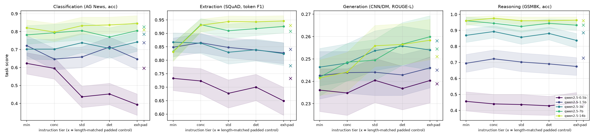
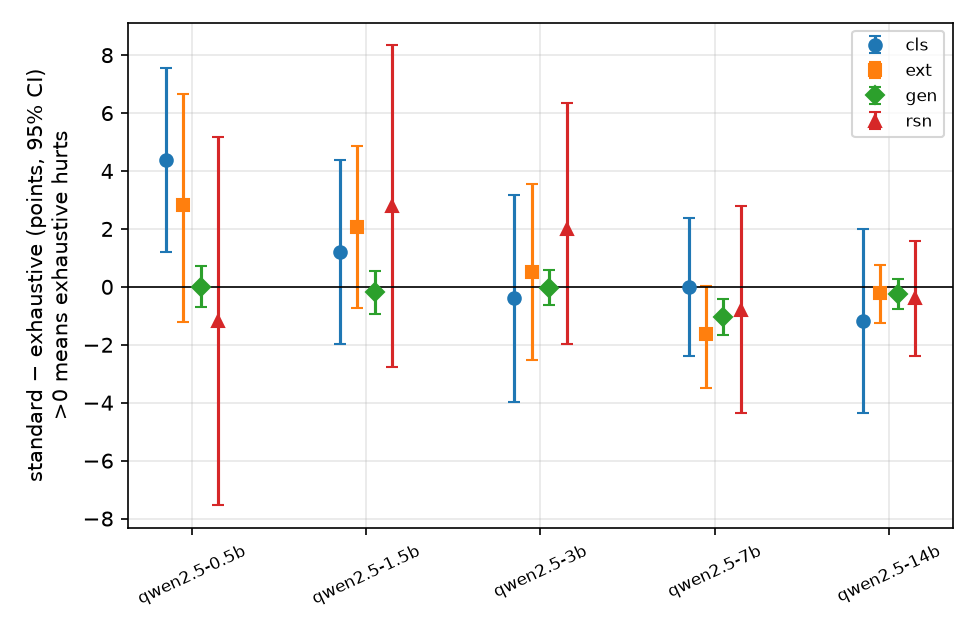
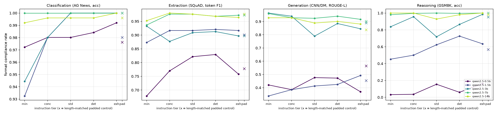

# Instruction Length and Task Performance: When More Detail Hurts

## 1. Executive Summary

**Question.** Does making a task instruction longer and more detailed (five nested tiers, ~18 → ~900 words) help or hurt LLM task performance and format compliance, and does the answer depend on task type and model size?

**Key finding.** For instruction-tuned Qwen2.5 models of **3B–14B parameters, instruction length barely matters**. Going from the *standard* tier (~150 words) to the *exhaustive* tier (~900 words) changed task scores by at most ±1.6 points on classification, extraction, generation, and reasoning. No such change survived multiple-comparison correction except a tiny +1.0 ROUGE-L *gain* for 7B on generation. The predicted 3–7 point "exhaustive penalty" for classification and extraction did **not** appear at 7B or 14B. Degradation from longer instructions appears **only in the smallest models (0.5B, and partly 1.5B)**. For 0.5B, classification accuracy fell from 62% (minimal) to 44% (standard) and 39% (exhaustive), mostly because predictions collapsed onto the label "Business". The size of the standard→exhaustive drop shrinks with model size (Spearman ρ = −0.9 across five Qwen sizes, for both classification and extraction). Yet 7B is *not* hurt more than 14B (difference-in-differences ≈ 0 to −1.4 pts, n.s.).

**Mechanism check.** A length-matched padding control (standard content + ~700 words of irrelevant filler) did **not** reproduce the small-model degradation. It actually *restored* 0.5B classification accuracy (59.5% vs 43.7% at standard). So the damage comes from the instruction **content and what sits right before the input**, not from token count ("attention dilution"). Moving the instruction into the system message weakened, but did not remove, the 0.5B decline.

**Practical implication.** For ≥3B instruction-tuned models, prompt authors can add detail freely: a short-but-specific (*concise*/*standard*) instruction captures nearly all the benefit, and extra length is roughly neutral. For sub-2B models, keep instructions minimal.

## 2. Research Question & Hypothesis

Hypotheses as given, decomposed and pre-registered in `planning.md`:

| ID | Claim |
|---|---|
| H1 | Classification and extraction peak at *standard*, then decline 3–7% at *exhaustive*. |
| H2 | Generation improves monotonically up to *detailed*. |
| H3 | Reasoning does not change with length beyond *concise*. |
| H4 | 7B models degrade more from exhaustive instructions than larger models. |
| H5 | Instruction (format) compliance peaks at *standard* for every task. |
| H6 (added) | A length-matched padded control separates "more tokens" (dilution) from "more content". |

**Motivation / gap.** Prior work shows LLMs degrade with longer or irrelevant *input context* (Shi et al. 2023, "LLMs can be easily distracted by irrelevant context"; Liu et al. 2023, "Lost in the Middle"; Levy et al. 2024, "Same Task, More Tokens"). It also shows instruction following degrades as the *number of constraints* grows (IFEval, FollowBench). Few studies grade the *task instruction itself* in controlled nested tiers, across task types and a within-family scale ladder, with a control that separates length from content. Note: the automated resource-finder stage was skipped for this workspace (no `papers/`, `datasets/`, `code/` were provided), so the literature context comes from background knowledge, not a fresh search.

## 3. Experimental Setup

### Models
No API keys were available on this host (`OPENROUTER_KEY` unset), so all models are real open-weight instruction-tuned checkpoints run locally with **vLLM 0.32.0**. Decoding was greedy (temperature 0, seed 42), with the default chat template and the instruction in the user turn.

| Model | Precision | Notes |
|---|---|---|
| Qwen2.5-0.5B-Instruct | bf16 | |
| Qwen2.5-1.5B-Instruct | bf16 | also run with system-message placement |
| Qwen2.5-3B-Instruct | bf16 | |
| Qwen2.5-7B-Instruct | bf16 | the "7B" of the hypothesis |
| Qwen2.5-14B-Instruct | bf16 | the "larger model" |
| ~~Llama-3.1-8B-Instruct-AWQ~~, ~~Qwen2.5-32B-Instruct-AWQ~~ | AWQ | **planned but not run**: the shared GPUs were taken by other users' jobs (≤5 GB free per GPU) for the rest of the session; every launch failed at startup (`logs/status.txt`). |

Hardware: shared 4× NVIDIA RTX A6000 (48 GB). Each run used one GPU slice of 5–42 GB. A full model run (6,048 prompts) took ~2 min (0.5B/1.5B), ~11 min (7B), and ~80 min (14B, KV-cache-starved because of contention). Max new tokens: 16 (classification), 64 (extraction), 200 (generation), 768 (reasoning). Max context: 4,096 tokens.

### Tasks and data
All data came from the local HuggingFace cache. Each task uses a fixed random sample (seed 42) of **n = 252 items**, and the same items are used in every condition, so all comparisons are paired.

| Type | Dataset | Primary metric | Core format constraint (stated in **every** tier) |
|---|---|---|---|
| Classification | AG News test (stratified, 63/class) | accuracy | answer only with one of World/Sports/Business/Sci/Tech |
| Extraction | SQuAD v1.1 validation (1 question/passage) | token F1 (also EM) | only a span copied verbatim from the passage |
| Generation | CNN/DailyMail 3.0.0 test (article truncated to 500 words) | ROUGE-L F1 vs highlights | 2–4 sentences, ≤ 80 words, summary only |
| Reasoning | GSM8K test | exact-match accuracy | last line `Final answer: <number>` |

### Conditions (instruction tiers)
Tiers are **nested**: each tier = the previous tier + one more block, so a longer tier never removes information. Full text is in `src/prompts.py`.

| Condition | Words (cls / ext / gen / rsn) | Prompt tokens incl. input (cls / ext / gen / rsn) | Content added |
|---|---|---|---|
| minimal | 19 / 18 / 19 / 18 | 112 / 230 / 621 / 117 | task + format constraint |
| concise | 55 / 50 / 50 / 40 | 172 / 273 / 658 / 142 | definitions / basics |
| standard | 163 / 172 / 165 / 141 | 323 / 439 / 809 / 270 | numbered guidelines, key decision rules |
| detailed | 387 / 360 / 343 / 316 | 605 / 672 / 1032 / 486 | edge cases, tie-breaking, quality criteria |
| exhaustive | 1018 / 866 / 897 / 820 | 1461 / 1325 / 1723 / 1091 | purpose/rationale, step-by-step procedure, many rules, "common mistakes", restated format, final reminder |
| **padded** (control) | = exhaustive (word-matched) | 1291 / 1225 / 1638 / 1038 | *standard* text + task-irrelevant office boilerplate filler |

### Metrics
- **Task score** uses *lenient* parsing, so a formatting slip does not count as a wrong answer. Classification takes the first label or synonym mentioned. Extraction takes the first line with "Answer:" prefixes and quotes stripped. Reasoning takes the number after "Final answer", falling back to the last number.
- **Compliance** uses *strict* parsing. Classification: output is exactly a label. Extraction: a single line that is a verbatim substring of the passage, ≤ 30 words. Generation: 2–4 sentences, ≤ 80 words, no bullets, markdown, or "Here is…" preamble. Reasoning: the last line matches `Final answer: <number>` exactly.

### Statistics
- Per model × task: bootstrap 95% CIs over items (5,000 resamples).
- Paired differences: bootstrap CI plus a two-sided sign-flip permutation test.
- Holm correction is applied (a) within the primary family of 20 standard-vs-exhaustive tests (5 models × 4 tasks), (b) within the 40 padding-control tests, and (c) across *all* ~400 comparisons (`p_holm` in `results/tests.csv`, very conservative).
- H2 uses an item-level linear slope over tiers minimal→detailed.
- H3 uses Cochran's Q plus equivalence (90% CI within ±3 pts).
- H4 uses an item-level paired difference-in-differences and a Spearman correlation of drop vs log(model size).

## 4. Results

### 4.1 Task scores by tier (n = 252 per cell)



*Figure 1. Task score vs instruction tier for five Qwen2.5 sizes; shaded areas are 95% bootstrap CIs and × marks the length-matched padded control.*

| Task | Model | minimal | concise | standard | detailed | exhaustive | padded |
|---|---|---|---|---|---|---|---|
| **cls** (acc) | 0.5B | **.623** | .595 | .437 | .452 | .393 | .595 |
| | 1.5B | .722 | .647 | .659 | .714 | .647 | **.738** |
| | 3B | .702 | .702 | .738 | .706 | .742 | **.786** |
| | 7B | .782 | .794 | .806 | .770 | .806 | **.825** |
| | 14B | .821 | .798 | .833 | .837 | **.845** | .810 |
| **ext** (F1) | 0.5B | **.733** | .723 | .677 | .700 | .649 | .732 |
| | 1.5B | .848 | **.865** | .848 | .838 | .827 | .840 |
| | 3B | **.867** | .863 | .830 | .839 | .824 | .779 |
| | 7B | .833 | **.932** | .910 | .917 | .926 | .908 |
| | 14B | .831 | .930 | .944 | .943 | **.946** | .929 |
| **gen** (ROUGE-L) | 0.5B | .236 | .235 | .240 | .237 | .240 | .239 |
| | 1.5B | .243 | .244 | .244 | .243 | .246 | .245 |
| | 3B | .246 | .248 | .254 | .256 | .254 | .258 |
| | 7B | .242 | .249 | .249 | .257 | **.260** | .254 |
| | 14B | .241 | .244 | .256 | .256 | **.258** | .251 |
| **rsn** (acc) | 0.5B | .456 | .440 | .437 | .429 | .448 | .433 |
| | 1.5B | .694 | .722 | .702 | .690 | .675 | .726 |
| | 3B | .869 | **.893** | .857 | .881 | .837 | .885 |
| | 7B | **.960** | .944 | .925 | .944 | .933 | .933 |
| | 14B | .960 | **.976** | .960 | .960 | .964 | .960 |

Reference points: random = .25 for AG News. The CI half-width is roughly ±5–6 pts for binary metrics and ±1 pt for ROUGE-L.

### 4.2 Primary contrast: standard − exhaustive (positive = exhaustive hurts)



*Figure 2. Standard − exhaustive difference per model and task, with 95% CIs.*

| Model | cls | ext | gen | rsn |
|---|---|---|---|---|
| 0.5B | **+4.4** [1.2, 7.5] p=.013 | +2.8 [−1.2, 6.7] | 0.0 | −1.2 |
| 1.5B | +1.2 [−2.0, 4.4] | +2.1 [−0.7, 4.9] | −0.2 | +2.8 |
| 3B | −0.4 | +0.5 | 0.0 | +2.0 |
| 7B | 0.0 [−2.4, 2.4] | −1.6 [−3.5, 0.0] p=.06 | **−1.0** [−1.7, −0.4] p=.001 | −0.8 |
| 14B | −1.2 [−4.4, 2.0] | −0.2 [−1.3, 0.8] | −0.3 | −0.4 |

Values are in points with 95% CIs. After Holm correction over these 20 tests, only 7B-gen remains significant (p_holm = .02), and its direction is that *exhaustive helps*. The 0.5B classification drop has p_holm = .25.

### 4.3 Format compliance by tier



*Figure 3. Strict format-compliance rate vs instruction tier.*

| Task | Model | min | conc | std | det | exh | pad |
|---|---|---|---|---|---|---|---|
| cls | 0.5B / 1.5B / 3B / 7B / 14B | .97/.93/.94/1.0/.99 | .98/.98/.98/1.0/1.0 | .98/1.0/1.0/1.0/1.0 | .98/1.0/1.0/1.0/1.0 | .99/1.0/1.0/1.0/1.0 | .98/.98/1.0/1.0/1.0 |
| ext | 0.5B / 1.5B / 3B / 7B / 14B | .68/.87/.93/.94/.95 | .77/.92/.88/.98/.98 | .82/.92/.91/.98/.98 | .83/.92/.91/.97/.97 | .76/.92/.90/.97/.96 | .78/.90/.90/.97/.98 |
| gen | 0.5B / 1.5B / 3B / 7B / 14B | .42/.34/.96/.96/.93 | .39/.39/.94/.93/.93 | .48/.41/.79/.93/.89 | .47/.43/.89/.94/.90 | .37/.49/.85/.92/.88 | .56/.45/.89/.90/.84 |
| rsn | 0.5B / 1.5B / 3B / 7B / 14B | .03/.45/.84/.98/1.0 | .04/.50/.96/1.0/1.0 | .16/.62/.72/1.0/.93 | .06/.73/.87/1.0/.98 | .16/.64/.98/1.0/1.0 | .02/.57/.95/1.0/.98 |

Compliance has a *unique* peak at *standard* in only 1 of 20 model × task cells (0.5B gen). Standard is part of a tie for the maximum in 5 more cells (cls 1.5B/3B/7B, ext 7B, rsn 7B), all at or near the 100% ceiling. The most common pattern is a **ceiling from concise onward** (≥7B: 93–100% everywhere). Non-compliance in reasoning is mostly markdown bolding (`**Final answer: 20**`) or LaTeX layouts. The exhaustive tier, which ends with an explicit format restatement, often has the *highest* reasoning compliance (3B: 98% vs 72% at standard).

### 4.4 Padding control (H6) and instruction placement

| Model / task | standard | exhaustive | padded | padded − standard | exhaustive − padded |
|---|---|---|---|---|---|
| 0.5B cls | .437 | .393 | .595 | **+15.9** (p_holm = .008) | **−20.2** (p_holm = .008) |
| 1.5B cls | .659 | .647 | .738 | **+7.9** (p_holm = .008) | **−9.1** (p_holm = .008) |
| 0.5B ext | .677 | .649 | .732 | +5.5 (n.s.) | **−8.3** (p_holm = .014) |
| ≥3B, all tasks | — | — | — | within ±5 pts, none significant after correction | — |

Holm correction here is over the 40 padding tests. Adding ~700 words of irrelevant filler **never significantly hurt any model on any task**. For the small models it significantly *helped* relative to standard.

**System-message placement** (robustness, 0.5B and 1.5B; `results/placement.csv`): with the instruction in the system turn, 0.5B classification is .766 / .718 / .679 / .718 / .643 (min → exh), compared with .623 / .595 / .437 / .452 / .393 in the user turn. The catastrophic drop at *standard* largely disappears, but a monotone ~12-pt decline from minimal to exhaustive remains. Extraction shows the same pattern (.787 → .715). For 1.5B the curves are flat-to-slightly-declining under both placements.

### 4.5 Hypothesis verdicts

| Hypothesis | Verdict | Evidence |
|---|---|---|
| **H1** cls/ext peak at standard, −3–7% at exhaustive | **Not supported** (for 3B–14B). Partially seen only at 0.5B, where the peak is at *minimal*, not standard. | Peak tiers: cls = minimal, minimal, exhaustive, standard (tied with exhaustive), exhaustive; ext = minimal, concise, minimal, concise, exhaustive (0.5B → 14B). Standard − exhaustive is ≤ +1.2 pts for ≥1.5B on cls and ≤ +2.1 on ext, all n.s. |
| **H2** generation monotone up to detailed | **Partially supported** for ≥3B; **not** for ≤1.5B. Effect is tiny. | Slope per tier (ROUGE-L pts): 3B +0.34 [0.10, 0.57], 7B +0.45 [0.21, 0.69], 14B +0.57 [0.32, 0.82]; all consecutive steps positive but individually n.s. 0.5B/1.5B slope ≈ 0. Gains continue to *exhaustive* (no plateau or decline). |
| **H3** reasoning insensitive beyond concise | **Largely supported** (no significant differences), but equivalence within ±3 pts is not established for most models. | Cochran's Q over concise→exhaustive: p = .93, .37, .056, .50, .30. 3B shows a −5.6 pt concise → exhaustive dip (90% CI [−9.5, −1.6]). 7B exhaustive output is 2× longer (437 vs 214 tokens: it follows the "verify" steps) with no accuracy change. |
| **H4** 7B degrades more than larger models | **Not supported** as stated (7B ≈ 14B). **Supported in a generalized form**: degradation decreases with size, but is concentrated below 2B. | 7B − 14B difference-in-differences: cls +1.2 [−3.2, 5.6], ext −1.4 [−3.4, 0.5], gen −0.8, rsn −0.4 (all n.s.). Spearman(log size, drop) = −0.9 (p = .037) for both cls and ext. |
| **H5** compliance peaks at standard for all tasks | **Not supported.** | Compliance saturates from *concise* for ≥7B. For small models the peak is scattered (minimal, detailed, exhaustive), and exhaustive is often best for the reasoning format. |
| **H6** degradation is token dilution | **Refuted** in this setup. | Length-matched filler never hurt; content-rich long instructions did (small models only). |

## 5. Analysis & Discussion

**Why no "more detail hurts" effect at 7B–14B?** Modern instruction-tuned models handle 1–1.7k-token prompts easily; that is far below the multi-thousand-token regimes where context-length degradation has been reported. Our exhaustive tiers are realistic and *consistent* (they elaborate, they don't contradict). Under these conditions extra rules are either redundant (classification, reasoning) or mildly helpful (generation, extraction span boundaries). The main lever is **minimal → concise/standard for extraction**: +10 to +11 F1 for 7B/14B, because the minimal prompt produces over-long spans (7B average answer length 5.0 words at minimal vs 3.1–3.3 afterwards; `results/diagnostics.csv`). Beyond that, length is neutral.

**What goes wrong in tiny models.** The 0.5B model's classification drop is a **label-collapse bias**: "Business" predictions rise from 152/252 (minimal) to 199 (standard) and 213 (exhaustive). Label words are mentioned at a balanced rate in every tier (e.g., exhaustive: World 14, Sports 11, Business 13, Sci/Tech 11 mentions), so this is not simple keyword frequency. The padded control has the *same* content as standard, yet it recovers accuracy, and system-message placement also mostly recovers it. Both point to **what immediately precedes the input in the user turn**. In *standard*, the article directly follows a rule list ending in "Output exactly one of … (World, Sports, Business, Sci/Tech)…". In *padded*, it follows neutral prose. For a 0.5B model, proximal rule text about company/tech/Business distinctions seems to prime a default label. This is a recency/interference effect of content, not a dilution effect of length. A residual ~12-pt minimal→exhaustive decline remains under system placement, so small models are genuinely harmed by detailed rule content.

**Generation.** ROUGE-L rises by ~1.5 pts from minimal to exhaustive for ≥3B. Guidance like "lead with the most newsworthy fact, use the article's key phrases" plausibly shifts outputs toward highlight-style content. The effect is real but small (ROUGE is a coarse proxy, and we have no human or LLM-judge quality evaluation). Small models ignore the guidance and also violate the 2–4 sentence / 80-word constraint >50% of the time at every tier.

**Surprises.**
1. Irrelevant filler is harmless, and even helpful, which runs against the "attention dilution" narrative.
2. The *minimal* tier is the best tier for 0.5B on 3 of 4 tasks.
3. Exhaustive instructions doubled 7B's reasoning length (it executes the prescribed "verify" step) at no accuracy cost: a cost/latency penalty rather than an accuracy one.
4. Restating the format at the end of the exhaustive prompt makes it the most format-compliant tier for reasoning.

**Error taxonomy** (`results/diagnostics.csv`, `results/error_examples.md`):
- Classification errors in ≥3B models are dominated by Sci/Tech → Business confusions (e.g., 7B: 21–35 per condition). These are tech-company business stories that AG News labels inconsistently, and their count barely varies with tier.
- Extraction errors shift from "span too long" (minimal) to a small residual of "not verbatim" or "wrong span".
- Generation non-compliance is mostly one-sentence summaries for ≥7B, and over-length or wrong sentence counts for small models.
- Reasoning errors are almost entirely wrong numbers for ≥3B; small models also emit markdown or LaTeX final lines.

## 6. Limitations

- **One model family for the scale analysis.** Llama-3.1-8B and Qwen2.5-32B were planned but could not be run because other users occupied the shared GPUs. Conclusions about "larger models" rest on Qwen2.5-14B only, and cross-family generality is untested.
- **One instruction wording per tier.** Wording and length are confounded within a tier. The nested design and padding control mitigate this but don't eliminate it, and a different exhaustive prompt (e.g., one with conflicting or over-specific rules) could well hurt. Our exhaustive prompts were written to be realistic and internally consistent.
- **Padding control is word-matched**, which gives 7–12% fewer tokens than exhaustive. It also changes *what precedes the input*, so "padded vs standard" mixes length with recency (discussed above).
- **n = 252 per cell.** Binary-metric CIs are ±5–6 pts, so the power to detect a 3-pt effect in one model × task cell is low. Pooled patterns (e.g., the size correlation, which uses only 5 points) should be read with that in mind.
- **Metrics.** ROUGE-L is a weak generation metric, and AG News labels are noisy (accuracy ceiling ~85–90%). Compliance definitions are strict and author-chosen.
- **Greedy decoding with a single seed.** Sampling variance is not assessed. Variability is captured only through item resampling. Generation runs were not repeated to confirm bit-exact reproducibility because the GPUs were unavailable at the end of the session. Scoring and analysis are deterministic given `results/raw/`.
- **Contamination.** All four datasets are public and likely seen in pre-training. This affects absolute levels more than within-model tier comparisons.

## 7. Conclusions & Next Steps

**Answer.** In this setup, more instruction detail mostly **does not hurt**. For 3B–14B Qwen2.5 models, task performance is flat (classification, reasoning) or slightly increasing (extraction after the concise tier, generation) from standard to exhaustive. The hypothesized 3–7% exhaustive penalty and the "7B suffers more than larger models" effect were not observed. Harm from longer, more detailed instructions is a **small-model phenomenon (≤1.5B)**. It is driven by instruction *content and its position*, not by token count.

**Practical guidance.**
1. Always include a concise task-specific definition. Minimal prompts leave large gains on the table for extraction.
2. For ≥3B models, adding detail beyond that is cheap insurance with no measurable accuracy cost, but it can increase output length (and hence latency) in reasoning.
3. Restating the output format at the very end of a long prompt helps compliance.
4. For sub-2B models, prefer minimal instructions, or put them in the system message.

**Follow-ups.**
- Run Llama-3.1-8B, Gemma, and ≥32B models, plus API models, to test cross-family generality.
- Write several paraphrases per tier to separate wording from length.
- Build "adversarial-realistic" exhaustive prompts with conflicting rules or excessive edge cases.
- Extend to longer instructions (5k–20k tokens, e.g., agent system prompts).
- Use LLM-judge or human evaluation for generation quality.
- Add a padding control token-matched at both start and end positions to disentangle recency from length.

## 8. Reproducibility

```bash
uv venv --python 3.12 && source .venv/bin/activate && uv sync   # or: uv add "vllm>=0.10" datasets pandas numpy scipy matplotlib rouge-score statsmodels
N_ITEMS=252 python src/data.py                 # builds datasets/*.jsonl from the HF cache
GPU=0 ./run_all.sh                              # one vLLM run per model -> results/raw/<model>.jsonl
python src/score.py                             # -> results/scored.csv
N_BOOT=5000 python src/analyze.py               # -> results/summary_table.csv, tests.csv, hypotheses.json, figures/
python src/diagnostics.py; python src/placement.py
```

Environment: Python 3.12.12, vllm 0.32.0, torch 2.13.0+cu130, pandas 3.0.6, numpy 2.3.5, scipy 1.18.1, rouge-score 0.1.2. Seeds: data sampling 42, vLLM seed 42, bootstrap RNG 42. Raw generations for every prompt are in `results/raw/`.

## References
- Shi et al. (2023). *Large Language Models Can Be Easily Distracted by Irrelevant Context.* ICML.
- Liu et al. (2023). *Lost in the Middle: How Language Models Use Long Contexts.* TACL 2024.
- Levy, Jacoby, Goldberg (2024). *Same Task, More Tokens: the Impact of Input Length on the Reasoning Performance of LLMs.* ACL.
- Zhou et al. (2023). *Instruction-Following Evaluation for Large Language Models (IFEval).*
- Jiang et al. (2023). *FollowBench.*
- Datasets: AG News (Zhang et al. 2015), SQuAD v1.1 (Rajpurkar et al. 2016), CNN/DailyMail (Hermann et al. 2015; See et al. 2017), GSM8K (Cobbe et al. 2021).
- Models: Qwen2.5 Technical Report (Qwen Team, 2024). Tools: vLLM (Kwon et al. 2023), rouge-score, SciPy, statsmodels.
